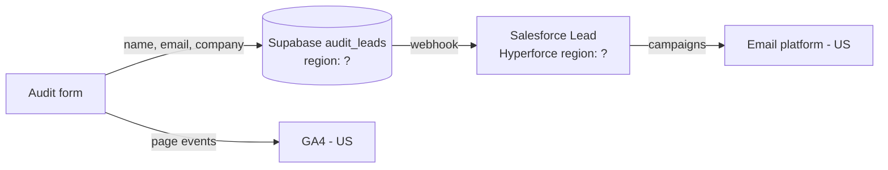

# Audit procedure

A repeatable POPIA + security audit for a website or application. Designed so two different people (or agents) running it on the same product reach the same findings.

## Contents
1. Engagement setup
2. Phase 1: Scope and context
3. Phase 2: Data mapping
4. Phase 3: Automated checks
5. Phase 4: Manual control review (master checklist)
6. Phase 5: Findings, scoring, report
7. Phase 6: Remediation and re-test
8. Evidence standards
9. Scoring the overall posture

---

## 1. Engagement setup

Confirm before starting:
- **Who is the responsible party?** (Your client? You? Both for different data?)
- **Who commissioned the audit** and who receives the report (IO, board, developer)?
- **Access granted**: repo (read), live URL, backend console (read-only), CRM, vendor list, policies. Never request production data exports for an audit; inspect structure and settings.
- **Authorisation for live testing**: only passive checks (`site_check.py`) without written permission. Active testing (auth bypass attempts, fuzzing) needs explicit written scope. Cybercrimes Act unlawful-access offences apply to unauthorised testing.
- **Disclaimer** in the report: engineering and compliance review, not a legal opinion.

## 2. Phase 1: Scope and context

Capture in the report header:
- Product name, URLs, environments, repos, mobile apps.
- Business model and users (consumers, businesses, employees, children?).
- Sectors with extra rules (financial, health, education, telecoms, insurance, credit).
- Data subject volume (order of magnitude).
- Hosting and key vendors (first pass).
- Information Officer name and **registration status** (ask for eServices confirmation).

## 3. Phase 2: Data mapping

For each **collection point** (form, API, import, integration, cookie, SDK, call recording, upload):
1. What fields? (Mark special PI, children's, ID/account numbers.)
2. Purpose and lawful basis (s11 / s27 / s35 / s69)?
3. Where is it stored? (Table, bucket, CRM object, spreadsheet, inbox.)
4. Who/what accesses it? (Roles, services, operators.)
5. Where does it go? (Integrations, exports, AI, analytics; countries.)
6. How long is it kept, and what deletes it?

Output: `templates/ropa.csv` filled, plus a simple flow diagram (Mermaid is fine):

Unknowns ("region: ?") become findings until resolved.

## 4. Phase 3: Automated checks

```bash
# code
python3 scripts/popia_scan.py ./repo --format md --out evidence/popia-scan.md
python3 scripts/popia_scan.py ./repo --format json --out evidence/popia-scan.json
# live site (passive)
python3 scripts/site_check.py https://example.co.za --out evidence/site-check.md --json evidence/site-check.json
# extra tools if available
gitleaks detect --source ./repo            # secrets in history
npm audit --omit=dev / pip-audit            # dependency vulns
semgrep --config p/owasp-top-ten ./repo     # broader SAST
```
For Supabase, also run the SQL in `04-stack-playbooks.md` §1 (read-only) and the Security Advisor.

Triage every scanner finding: **confirmed**, **false positive** (say why), or **needs info**. Never paste scanner output into the report without triage.

## 5. Phase 4: Manual control review (master checklist)

Mark each: ✅ Met · ⚠️ Partial · ❌ Not met · ➖ N/A · ❓ Unknown (unknown on a key control is itself a finding).

### Accountability (s8, s55, Reg 4)
| ID | Control |
|---|---|
| ACC-01 | Information Officer designated and **registered** on eServices portal |
| ACC-02 | Deputy IO(s) designated and registered where needed |
| ACC-03 | POPIA compliance framework/policy exists and is owned |
| ACC-04 | PIA performed for the product / high-risk processing |
| ACC-05 | PAIA manual published and accessible (website) |
| ACC-06 | Staff awareness training conducted (records) |
| ACC-07 | ROPA exists and is current |
| ACC-08 | Privacy considered in SDLC (design review, PR checklist, CI scan) |

### Processing limitation (s9 to s12)
| ID | Control |
|---|---|
| PL-01 | Lawful basis identified for every processing purpose |
| PL-02 | No excessive fields (each field maps to a purpose) |
| PL-03 | Consent, where relied on, is voluntary, specific, informed, recorded |
| PL-04 | Consent withdrawal mechanism works and is as easy as giving it |
| PL-05 | Objection route (s11(3)) available and honoured |
| PL-06 | PI collected directly from data subject, or exception documented |
| PL-07 | Legitimate interest uses have a balancing assessment |
| PL-08 | Optional vs mandatory fields clearly indicated |

### Purpose specification and retention (s13, s14)
| ID | Control |
|---|---|
| PS-01 | Purposes defined and documented per data set |
| PS-02 | Retention period defined per data set with legal basis for period |
| PS-03 | Automated deletion/de-identification enforces retention |
| PS-04 | Deletion reaches replicas, search indexes, analytics, warehouses, vendors |
| PS-05 | Backup retention defined and disclosed |
| PS-06 | Deletion method prevents reconstruction (s14(5)) |
| PS-07 | De-identification method is robust (quasi-identifiers removed) |

### Further processing (s15)
| ID | Control |
|---|---|
| FP-01 | New uses (analytics, AI training, marketing, sharing) assessed for compatibility |
| FP-02 | No repurposing of service data for marketing without basis |

### Information quality (s16)
| ID | Control |
|---|---|
| IQ-01 | Users can update their details; validation on input |
| IQ-02 | Stale data review (e.g. bounce handling, re-verification) |

### Openness (s17, s18)
| ID | Control |
|---|---|
| OP-01 | Privacy notice published, linked in footer and at every collection point |
| OP-02 | Notice covers all s18(1) items (see template) |
| OP-03 | Notice names Information Officer contact and Regulator contact details |
| OP-04 | Notice lists categories of operators/recipients and cross-border transfers |
| OP-05 | Cookie notice accurate to what the site actually sets (site_check) |
| OP-06 | Notice version-controlled with effective date |
| OP-07 | ECTA s43 business info displayed (if selling online) |

### Security safeguards (s19 to s22)
Run all controls in `03-security-controls.md` (IDs `SEC-*`). At minimum for every audit:
| ID | Control |
|---|---|
| SEC-AZ-02 | RLS/security rules on every PI table/collection |
| SEC-AZ-04 | No admin/service keys client-side |
| SEC-AZ-06 | Private storage for PI files |
| SEC-CR-01 | TLS + HSTS |
| SEC-CR-03 | Field-level protection for high-risk PI |
| SEC-CR-04 | No secrets in repo/bundles/history |
| SEC-IAM-01 | MFA on admin/cloud/DB/CRM/email |
| SEC-APP-03/04 | CSP and security headers |
| SEC-LOG-02 | PI redacted from logs |
| SEC-BCK-02 | Restore tested |
| SEC-VUL-01 | Dependency vulns within SLA |
| SEC-SUP-02 | Operator agreements with s21 terms |
| BR-01..08 | Breach readiness (07-breach-response.md) |

### Data subject participation (s23 to s25)
| ID | Control |
|---|---|
| DSP-01 | Access request process (confirm free; provide copy) with identity verification |
| DSP-02 | Correction process (Form 2 accepted) |
| DSP-03 | Deletion process incl. "delete account" and explanation of retained data |
| DSP-04 | Requests logged with dates and outcomes |
| DSP-05 | Response within defined SLA (target ≤ 30 days) |
| DSP-06 | Export in usable format |

### Special personal information (s26 to s33)
| ID | Control |
|---|---|
| SPI-01 | Inventory of special PI fields (incl. biometrics, health, race, beliefs, criminal) |
| SPI-02 | s27 ground documented for each |
| SPI-03 | Explicit, separate consent where consent is the ground |
| SPI-04 | Stricter access, encryption, exclusion from analytics/marketing/AI training |
| SPI-05 | Prior authorisation assessed (s57) where applicable |

### Children (s34, s35)
| ID | Control |
|---|---|
| CHI-01 | Determined whether children use the service (DOB/age/school fields, audience) |
| CHI-02 | Age gate or competent-person consent flow as appropriate |
| CHI-03 | Children's data minimised; no behavioural ads |
| CHI-04 | Cross-border transfer of children's data assessed for s57(1)(d) |

### Direct marketing (s69) → `05-direct-marketing.md` DM-01..12
### Cross-border and operators (s20, s21, s72) → `06-cross-border-and-operators.md` XB-01..09
### AI and automated decisions (s71) → `08-ai-and-automated-decisions.md` AI-01..12
### Prior authorisation (s57)
| ID | Control |
|---|---|
| PA-01 | Unique identifiers linked across organisations for new purpose? Authorisation obtained? |
| PA-02 | Credit reporting / criminal behaviour on behalf of third parties? Authorisation obtained? |

## 6. Phase 5: Findings, scoring, report

Each finding:
```
ID:         F-07
Control:    SEC-AZ-02 (s19)
Severity:   Critical
Title:      audit_leads table readable by anonymous users
Evidence:   migration 20260712_create_leads.sql:4 creates table without RLS; curl with anon key returned 1,204 rows (redacted sample in evidence/F-07.txt)
Risk:       Any visitor can download all leads (names, emails, phone numbers). Likely s22 notifiable if accessed.
Fix:        Enable RLS; insert-only policy for anon; read via service role server-side. (SQL attached.)
Owner:      Dev lead
Due:        Immediately; before next deploy
Status:     Open
```
Severity rubric is in SKILL.md. Rules:
- An exposed-data Critical also triggers the **breach question**: was it accessed? Check logs, advise per 07-breach-response.md.
- Group duplicates (same root cause across 12 tables = one finding, list tables).
- Write fixes as concrete diffs/snippets where possible.

Use `templates/audit-report.md`.

## 7. Phase 6: Remediation and re-test

- Fix Critical → High → Medium. Re-run scanner and site_check; attach before/after counts.
- Mark findings Closed only with evidence.
- Add the scanner to CI (`--format sarif --fail-on high`) so regressions are blocked. Example workflow in `.github/workflows/popia-scan.yml` of this repo.
- Schedule the next review (verification cadence in 03-security-controls.md §12).

## 8. Evidence standards

- File:line references, config screenshots, command output with timestamps.
- **Redact PI in evidence** (mask emails `l***@domain`, IDs `******123****`). Evidence folders are a breach risk too.
- Store evidence with the same protection as the data it describes; delete after the engagement's retention period.

## 9. Overall posture score

Give a simple score per condition so non-technical readers get the picture:

| Rating | Meaning |
|---|---|
| **Strong** | All key controls met; minor gaps only |
| **Adequate** | Key controls met; some Medium gaps |
| **Weak** | Any High open, or several key controls partial |
| **Critical** | Any Critical open |

Overall rating = worst of: Security safeguards, Processing limitation, Openness, Accountability.
